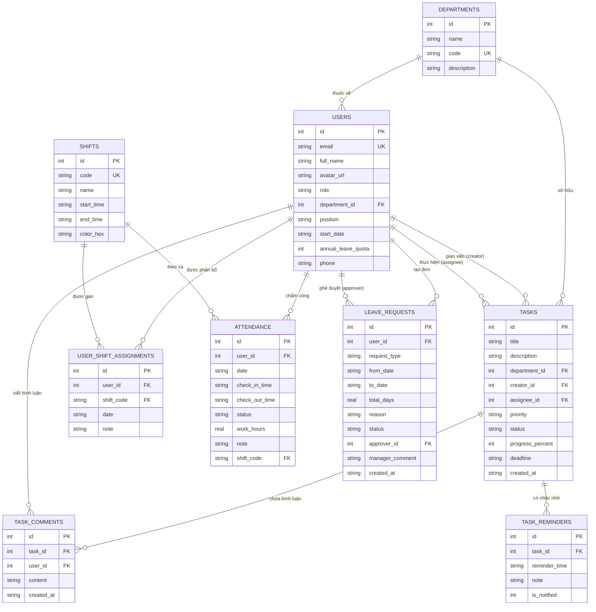

# BÁO CÁO ĐẶC TẢ NGHIỆP VỤ VÀ THIẾT KẾ KỸ THUẬT HỆ THỐNG QUẢN LÝ NHÂN SỰ CÔNG TY (ASOFT-HRM)

> **Môn học**: PRM / Mobile Application Development  
> **Đề tài**: Hệ thống Quản lý Nhân sự & Phê duyệt Doanh nghiệp (ASOFT-HRM)  
> **Nhóm thực hiện**: 2 thành viên (**Duy Ngọc**, **Uyên**)  
> *(Ghi chú: Toàn bộ phạm vi công việc 15 màn hình nghiệp vụ đã được cân đối và chia đều giữa 2 thành viên Duy Ngọc và Uyên)*  
> **Phiên bản tài liệu**: 2.0 (Cập nhật hoàn thiện)  
> **Ngày lập**: 04/11/2026  

---

## MỤC LỤC

1. [GIỚI THIỆU HỆ THỐNG & PHẠM VI TÀI LIỆU](#1-giới-thiệu-hệ-thống--phạm-vi-tài-liệu)
   - 1.1. Bối cảnh và Mục tiêu đề tài
   - 1.2. Đối tượng sử dụng hệ thống (Actors)
   - 1.3. Phạm vi nghiệp vụ (In-Scope & Out-of-Scope)
   - 1.4. Phân công trách nhiệm nhóm 2 thành viên
2. [DANH SÁCH TÍNH NĂNG VÀ PHÂN CÔNG TRÁCH NHIỆM (FEATURE LIST)](#2-danh-sách-tính-năng-và-phân-công-trách-nhiệm-feature-list)
   - 2.1. Module 1: Quản lý Xác thực & Hồ sơ (Authentication & Profile)
   - 2.2. Module 2: Quản lý Chấm công & Điểm danh (Attendance & Timekeeping)
   - 2.3. Module 3: Quản lý Quỹ phép & Đơn từ (Leave & Request Management)
   - 2.4. Module 4: Quản lý Thẩm định & Phê duyệt (Approval Workflow)
   - 2.5. Module 5: Quản lý Công việc Phòng ban & Kanban (Department Task & Kanban)
   - 2.6. Module 6: Thảo luận Nội bộ & Nhắc nhở (Collaboration & Notification)
3. [ĐẶC TẢ TÀI LIỆU API (API DOCUMENTATION)](#3-đặc-tả-tài-liệu-api-api-documentation)
   - 3.1. Bảng tổng quan danh mục API
   - 3.2. Đặc tả chi tiết từng Endpoint API (Request/Response JSON & Rules)
4. [ĐẶC TẢ DỮ LIỆU & QUY TẮC NGHIỆP VỤ (DATA DOCUMENTATION)](#4-đặc-tả-dữ-liệu--quy-tắc-nghiệp-vụ-data-documentation)
   - 4.1. Sơ đồ Quan hệ Thực thể ERD (Entity Relationship Diagram)
   - 4.2. Cấu trúc chi tiết 9 Bảng Cơ sở dữ liệu
   - 4.3. Quan hệ giữa các bảng và Ràng buộc Toàn vẹn
   - 4.4. Quy tắc nghiệp vụ dữ liệu chuyên sâu (Business Rules Engine)
5. [KẾT LUẬN & HƯỚNG PHÁT TRIỂN](#5-kết-luận--hướng-phát-triển)

---

## 1. GIỚI THIỆU HỆ THỐNG & PHẠM VI TÀI LIỆU

### 1.1. Bối cảnh và Mục tiêu đề tài
Trong kỷ nguyên chuyển đổi số và xu hướng làm việc linh hoạt (hybrid working), các doanh nghiệp vừa và lớn đòi hỏi một giải pháp quản trị nhân sự tập trung, minh bạch, có khả năng xử lý nghiệp vụ tức thì trên thiết bị di động.  
Hệ thống **ASOFT-HRM** được xây dựng nhằm tin học hóa và tối ưu toàn diện các hoạt động:
* Điểm danh chấm công thông minh, xác định vị trí và phân loại chính xác tình trạng đi đúng giờ, đi trễ, về sớm theo từng ca làm việc.
* Quản lý quỹ phép năm tự động lũy tiến theo số tháng thâm niên và áp dụng chính sách đãi ngộ thưởng thêm ngày phép cho nhân sự gắn bó lâu năm.
* Thiết lập quy trình thẩm định - phê duyệt đơn từ phân cấp linh hoạt (1 cấp cho đơn ngắn ngày, 2 cấp cho đơn dài ngày) và hỗ trợ duyệt hàng loạt (Batch Approval).
* Tổ chức bảng Kanban công việc phòng ban, phân công nhiệm vụ, cập nhật tiến độ thanh trượt trực quan, trao đổi bình luận nội bộ và kích hoạt thông báo nhắc nhở hạn chót (Deadline Notifications).

### 1.2. Đối tượng sử dụng hệ thống (Actors)
* **Nhân viên (Employee)**: Điểm danh vào/ra ca, theo dõi lịch ca tuần, kiểm tra quỹ phép khả dụng, nộp đơn xin nghỉ/giải trình/đổi ca, theo dõi tiến độ công việc được giao và tham gia bình luận trao đổi.
* **Quản lý / Trưởng bộ phận (Manager)**: Theo dõi báo cáo chấm công chuyên cần của toàn phòng ban, thẩm định hồ sơ quota phép của nhân viên, phê duyệt hoặc từ chối đơn lẻ, duyệt hàng loạt, khởi tạo và phân công nhiệm vụ công việc trên Kanban.
* **Ban Giám đốc / Giám đốc Nhân sự (Director / HR Manager)**: Tham gia phê chuẩn cấp 2 đối với các đơn xin nghỉ phép dài ngày (> 2 ngày) theo quy định công ty.

### 1.3. Phạm vi nghiệp vụ (In-Scope & Out-of-Scope)
* **Trong phạm vi (In-Scope)**:
  * Đăng nhập xác thực Google / Gmail và Demo Account Switcher.
  * Quản lý hồ sơ nhân sự, hợp đồng, chức vụ và ngày bắt đầu làm việc.
  * Điểm danh Check-in / Check-out, tính toán giờ công thực tế, cảnh báo vi phạm khung giờ ca.
  * Thống kê chấm công cá nhân với lịch TableCalendar và báo cáo chuyên cần phòng ban.
  * Quỹ phép thông minh tính theo thâm niên làm việc (tháng/năm).
  * Lập đơn xin nghỉ, đơn giải trình quên quẹt thẻ, đơn xin đổi ca.
  * Thẩm định đơn, kiểm tra chéo quota phép, duyệt đơn đa cấp và duyệt hàng loạt.
  * Bảng điều phối công việc Kanban (To Do, In Progress, Done) kèm thanh trượt tiến độ (0% - 100%).
  * Hệ thống trao đổi bình luận công việc nội bộ và thiết lập mốc nhắc nhở Local Notifications.
* **Ngoài phạm vi (Out-of-Scope)**:
  * Tính lương chi tiết, khấu trừ thuế thu nhập cá nhân và đóng bảo hiểm xã hội (Payroll).
  * Quản lý tuyển dụng, tiếp nhận hồ sơ ứng viên (Recruitment).
  * Quản lý khóa đào tạo nội bộ (Training).
  * Đánh giá hiệu suất nhân sự cuối năm theo chuẩn OKR/KPI (Performance Evaluation).

### 1.4. Phân công trách nhiệm nhóm 2 thành viên
Theo cấu trúc tổ chức dự án hiện tại với 2 thành viên chính, toàn bộ 15 màn hình nghiệp vụ liên thông và các màn hình Core dùng chung được phân chia đồng đều và chuyên biệt hóa theo vai trò:

| Thành viên | Vai trò dự án | Phạm vi màn hình & Nghiệp vụ phụ trách | Số lượng màn hình |
|:---|:---|:---|:---:|
| **Duy Ngọc** | **Lead Developer / Quản lý điều hành** | **Phân hệ Chấm công, Phê duyệt Quản lý & Điều phối Nhiệm vụ**:<br>• Màn 1: Check-in Điểm danh GPS & Cảnh báo đi trễ.<br>• Màn 2: Bảng Chấm công cá nhân & Calendar tháng.<br>• Màn 3: Danh sách đơn chờ duyệt & Duyệt hàng loạt (Batch Approval).<br>• Màn 4: Thẩm định hồ sơ & Phê duyệt đơn chi tiết.<br>• Màn 5: Báo cáo Chấm công & Chuyên cần phòng ban.<br>*(Nhận thêm từ phần việc P.Anh)*:<br>• Màn 11: Bảng Kanban Công việc phòng ban & Lọc trạng thái.<br>• Màn 12: Giao việc & Phân công nhiệm vụ (Assignee, Priority, Deadline).<br>• Core: Màn hình Đăng nhập & Demo Role Switcher. | **7 màn hình chính + Core** |
| **Uyên** | **Core Developer / Nghiệp vụ Nhân sự** | **Phân hệ Quỹ phép, Đơn từ Cá nhân & Tương tác Thực thi**:<br>• Màn 6: Quỹ phép thông minh theo thâm niên & Thưởng thâm niên.<br>• Màn 7: Lập đơn xin nghỉ / Giải trình đi trễ / Đổi ca trực tuyến.<br>• Màn 8: Danh sách đơn từ cá nhân & Lọc trạng thái.<br>• Màn 9: Chi tiết đơn từ & Tiến trình duyệt đa cấp, Hủy đơn.<br>• Màn 10: Lịch Phân ca tuần & Phím tắt đổi ca.<br>*(Nhận thêm từ phần việc P.Anh)*:<br>• Màn 13: Chi tiết nhiệm vụ & Slider cập nhật tiến độ (0% - 100%).<br>• Màn 14: Thảo luận & Bình luận trao đổi nội bộ task.<br>• Màn 15: Thiết lập mốc nhắc nhở & Local Notification.<br>• Core: Màn hình Hồ sơ nhân sự cá nhân (Profile). | **8 màn hình chính + Core** |

---

## 2. DANH SÁCH TÍNH NĂNG VÀ PHÂN CÔNG TRÁCH NHIỆM (FEATURE LIST)

### 2.1. Module 1: Quản lý Xác thực & Hồ sơ (Authentication & Profile Management)

| Mã FT | Tên tính năng | Mô tả chức năng | Actor | Phụ trách | Nghiệp vụ chính | Input | Output | Điều kiện tiên quyết | Kết quả sau thực hiện |
|:---:|:---|:---|:---:|:---:|:---|:---|:---|:---|:---|
| **FT-01** | Đăng nhập Google / Demo Role Switcher | Cho phép người dùng đăng nhập qua tài khoản Google hoặc lựa chọn tài khoản demo để trải nghiệm vai trò Manager / Employee. | All | Duy Ngọc | • Xác thực tài khoản.<br>• Tải thông tin phòng ban & quyền hạn.<br>• Đồng bộ hóa dữ liệu State Management. | Email, Chọn User từ danh sách demo | Token phiên làm việc, Đối tượng `User` hiện tại | Ứng dụng đã khởi tạo DB cục bộ | Chuyển hướng vào màn hình điều hướng chính (`MainNavigationShell`) |
| **FT-02** | Xem Hồ sơ Nhân sự Cá nhân | Hiển thị hồ sơ chi tiết của nhân sự gồm thông tin chức vụ, phòng ban, số điện thoại, ngày vào làm và hạn mức phép cơ bản. | All | Uyên | • Truy vấn thông tin cá nhân.<br>• Hiển thị thông số hợp đồng.<br>• Cung cấp chức năng Đăng xuất. | ID nhân sự đăng nhập | Giao diện hồ sơ cá nhân đầy đủ thông số | Người dùng đã đăng nhập thành công | Xem được toàn bộ thông tin công tác cá nhân |

### 2.2. Module 2: Quản lý Chấm công & Điểm danh (Attendance & Timekeeping Management)

| Mã FT | Tên tính năng | Mô tả chức năng | Actor | Phụ trách | Nghiệp vụ chính | Input | Output | Điều kiện tiên quyết | Kết quả sau thực hiện |
|:---:|:---|:---|:---:|:---:|:---|:---|:---|:---|:---|
| **FT-03** | Check-in Điểm danh Ca & Bắt lỗi Đi trễ | Thực hiện quẹt thẻ vào ca, hiển thị đồng hồ số thời gian thực, vị trí văn phòng và tự động gán cờ `LATE` nếu vào sau 08:15 (CA01) hoặc 14:15 (CA02). | Employee, Manager | Duy Ngọc | • Kiểm tra ca làm việc hôm nay.<br>• So sánh giờ thực tế với ngưỡng trễ ca.<br>• Hiển thị cảnh báo đỏ và shortcut tạo đơn giải trình. | `userId`, `shiftCode`, Giờ hiện tại | Bản ghi `Attendance` mới với trạng thái `ON_TIME` hoặc `LATE` | Chưa Check-in trong ngày | Cập nhật trạng thái điểm danh hôm nay, kích hoạt nút Check-out |
| **FT-04** | Check-out Kết thúc Ca & Tính công | Ghi nhận giờ ra về, tự động tính toán tổng số giờ làm việc thực tế (`workHours`) và gán trạng thái `EARLY_LEAVE` nếu về sớm trước giờ quy định. | Employee, Manager | Duy Ngọc | • Tính khoảng thời gian làm việc.<br>• Đánh giá giờ về sớm trước 17:00 (CA01) hoặc 22:00 (CA02).<br>• Cập nhật bản ghi chấm công. | Bản ghi Check-in hiện tại, Giờ ra | Trạng thái chấm công hoàn tất, Số giờ làm việc | Đã thực hiện Check-in trước đó | Hoàn tất phiên làm việc trong ngày |
| **FT-05** | Bảng Chấm công Cá nhân & Calendar Tháng | Thống kê số ngày đi làm, số ngày đúng giờ, số lần đi trễ, tổng giờ làm trong tháng và xem chi tiết theo từng ngày trên TableCalendar. | Employee, Manager | Duy Ngọc | • Tổng hợp số liệu chấm công tháng.<br>• Hiển thị lịch chấm công với chấm màu trực quan.<br>• Lọc lịch sử quẹt thẻ theo ngày chọn. | `userId`, Tháng/Năm xem | Thẻ thống kê 4 chỉ số, Lịch chấm công, Danh sách quẹt thẻ chi tiết | Người dùng có dữ liệu chấm công | Nắm bắt được toàn diện kỷ luật chuyên cần cá nhân |
| **FT-06** | Báo cáo Chấm công Phòng ban | Cung cấp cho Quản lý bức tranh tổng thể về tỷ lệ chuyên cần của toàn bộ nhân sự trong phòng ban theo từng ngày. | Manager | Duy Ngọc | • Tính tỷ lệ % chuyên cần phòng ban.<br>• Đếm số người có mặt, đi trễ, vắng mặt.<br>• Chuyển đổi linh hoạt giữa ngày hôm nay và ngày mẫu. | `departmentId`, Ngày xem báo cáo | Tỷ lệ %, Số liệu thống kê, Danh sách trạng thái từng nhân viên | Người dùng có vai trò `MANAGER` | Quản lý kiểm soát được quân số làm việc hàng ngày |

### 2.3. Module 3: Quản lý Quỹ phép & Đơn từ (Leave & Request Management)

| Mã FT | Tên tính năng | Mô tả chức năng | Actor | Phụ trách | Nghiệp vụ chính | Input | Output | Điều kiện tiên quyết | Kết quả sau thực hiện |
|:---:|:---|:---|:---:|:---:|:---|:---|:---|:---|:---|
| **FT-07** | Bảng Quỹ phép Thông minh theo Thâm niên | Hiển thị thẻ chỉ số phép năm tự động tính toán: số tháng làm việc, hạn mức tích lũy, số ngày đã nghỉ, ngày chờ duyệt và quota khả dụng còn lại. | Employee, Manager | Uyên | • Tính số tháng thâm niên cống hiến.<br>• Tích lũy 1 ngày/tháng cho nhân sự < 1 năm.<br>• Thưởng thâm niên +2 đến +5 ngày cho nhân sự $\ge 2$ năm. | `User`, Danh sách đơn xin nghỉ | Thẻ Quỹ phép với thanh vòng tròn %, Số ngày khả dụng | Người dùng đã đăng nhập | Nắm rõ quyền lợi ngày phép năm hiện tại |
| **FT-08** | Lập Đơn xin nghỉ / Giải trình / Đổi ca | Form tạo đơn trực tuyến hỗ trợ 5 loại đơn: Nghỉ phép năm, Nghỉ ốm BHXH, Nghỉ không lương, Giải trình đi trễ, Xin đổi ca làm việc. | Employee | Uyên | • Tự tính số ngày xin nghỉ.<br>• Cố định 0.0 ngày cho đơn Giải trình và Đổi ca.<br>• Kiểm tra quota và chặn trùng lịch. | Loại đơn, Ngày bắt đầu, Ngày kết thúc, Lý do chi tiết | Bản ghi `LeaveRequest` trạng thái `PENDING` | Hạn mức phép khả dụng đủ (nếu là đơn phép năm) | Đơn được gửi tới danh sách chờ duyệt của Quản lý |
| **FT-09** | Danh sách Đơn từ Cá nhân | Xem toàn bộ các đơn từ do chính mình nộp, phân loại nhanh theo các tab lọc trạng thái (Tất cả, Chờ duyệt, Đã duyệt, Từ chối). | Employee | Uyên | • Lấy danh sách đơn từ cá nhân.<br>• Lọc theo trạng thái phê duyệt.<br>• Hiển thị lý do và phản hồi của Quản lý. | `userId`, Trạng thái lọc | Danh sách thẻ đơn từ cá nhân | Đã có tài khoản nhân sự | Dễ dàng theo dõi tiến độ xử lý đơn |
| **FT-10** | Chi tiết Đơn từ & Timeline Phê duyệt Đa cấp | Xem chi tiết nội dung đơn, theo dõi tiến trình phê duyệt trực quan (1 cấp hoặc 2 cấp) và hỗ trợ hủy đơn khi còn đang chờ duyệt. | Employee | Uyên | • Hiển thị thông số đơn chi tiết.<br>• Hiển thị Timeline duyệt động 1 cấp / 2 cấp.<br>• Cho phép Hủy bỏ đơn `PENDING`. | `requestId` | Giao diện chi tiết đơn từ, Trạng thái cập nhật `CANCELLED` | Đơn thuộc quyền sở hữu của nhân viên | Hủy đơn thành công, hoàn trả quota phép tức thì |
| **FT-11** | Lịch Phân ca Làm việc Tuần & Đổi ca | Xem lịch làm việc 7 ngày trong tuần được phân bổ (CA01 hành chính, CA02 chiều/tối) và nút tắt nộp đơn xin đổi ca tiện lợi. | Employee | Uyên | • Hiển thị ca làm việc theo ngày.<br>• Nhận diện ca ngày / ca chiều qua màu sắc.<br>• Bấm đổi ca tự động điền form `SHIFT_SWAP`. | `userId` | Lịch phân ca tuần, Mở form tạo đơn đổi ca | Đã được phân ca trong hệ thống | Giúp nhân viên chủ động sắp xếp thời gian làm việc |

### 2.4. Module 4: Quản lý Thẩm định & Phê duyệt (Approval Workflow Management)

| Mã FT | Tên tính năng | Mô tả chức năng | Actor | Phụ trách | Nghiệp vụ chính | Input | Output | Điều kiện tiên quyết | Kết quả sau thực hiện |
|:---:|:---|:---|:---:|:---:|:---|:---|:---|:---|:---|
| **FT-12** | Danh sách Đơn chờ duyệt & Duyệt hàng loạt | Màn hình dành cho Quản lý xem toàn bộ đơn từ của nhân sự trong phòng ban, hỗ trợ Checkbox để duyệt hàng loạt nhiều đơn cùng lúc. | Manager | Duy Ngọc | • Danh sách tab Chờ duyệt / Đã xử lý.<br>• Chọn / Bỏ chọn tất cả đơn chờ duyệt.<br>• Thực thi Batch Approval trong 1 thao tác. | `departmentId`, Danh sách `requestIds` đã chọn | Số lượng đơn được chuyển sang `APPROVED` | Người dùng có vai trò `MANAGER` | Toàn bộ đơn được chọn chuyển trạng thái `APPROVED` |
| **FT-13** | Thẩm định & Phê duyệt Đơn chi tiết | Xem nội dung đơn, tự động tải hồ sơ thâm niên và hạn mức quỹ phép còn lại của nhân viên, nhập ý kiến phản hồi để Phê duyệt hoặc Từ chối. | Manager | Duy Ngọc | • Kiểm tra chéo quota nhân viên.<br>• Cảnh báo đỏ nếu nhân viên xin vượt quota.<br>• Nhận diện quy trình duyệt 1 cấp hay 2 cấp.<br>• Ghi nhận phản hồi và cập nhật trạng thái. | `requestId`, `managerId`, Quyết định (Duyệt/Từ chối), Nhận xét | Trạng thái đơn đổi thành `APPROVED` hoặc `REJECTED` | Đơn đang ở trạng thái `PENDING` | Nhân viên nhận được kết quả phê duyệt trong danh sách đơn |

### 2.5. Module 5: Quản lý Công việc Phòng ban & Kanban (Department Task & Kanban Management)

| Mã FT | Tên tính năng | Mô tả chức năng | Actor | Phụ trách | Nghiệp vụ chính | Input | Output | Điều kiện tiên quyết | Kết quả sau thực hiện |
|:---:|:---|:---|:---:|:---:|:---|:---|:---|:---|:---|
| **FT-14** | Bảng Kanban Công việc Phòng ban | Trực quan hóa toàn bộ đầu việc của phòng ban IT theo các cột trạng thái: Chưa làm (TODO), Đang làm (IN_PROGRESS), Hoàn thành (DONE). | All | Duy Ngọc | • Lấy danh sách nhiệm vụ phòng ban.<br>• Lọc nhanh theo cột Kanban.<br>• Cảnh báo cờ đỏ đối với task quá hạn (Overdue). | `departmentId`, Bộ lọc cột Kanban | Danh sách thẻ công việc kèm tiến độ %, Assignee, Deadline | Người dùng thuộc phòng ban tương ứng | Nắm bắt tiến độ chung của toàn dự án |
| **FT-15** | Giao việc & Chỉnh sửa Nhiệm vụ | Màn hình khởi tạo công việc mới hoặc cập nhật task hiện có: chọn người phụ trách cùng phòng ban, mức độ ưu tiên, hạn chót ngày giờ. | Manager, Employee | Duy Ngọc | • Nhập tiêu đề, mô tả yêu cầu bàn giao.<br>• Chọn Assignee từ danh sách nhân sự cùng phòng.<br>• Chọn Priority (High, Med, Low), Deadline ngày giờ.<br>• Lưu mới hoặc Cập nhật task cũ. | Thông tin Form Task, `taskToEdit` (nếu có) | Bản ghi `TaskItem` được lưu thành công vào CSDL | Thuộc cùng phòng ban | Nhiệm vụ mới xuất hiện trên bảng Kanban |
| **FT-16** | Chi tiết Nhiệm vụ & Cập nhật Tiến độ Slider | Xem yêu cầu chi tiết của task, kéo Slider thanh trượt (0% - 100%) để cập nhật tiến độ và tự động đồng bộ trạng thái Kanban tương ứng. | All | Uyên | • Kéo Slider cập nhật % hoàn thành.<br>• Đổi trạng thái tự động theo % (100% $\rightarrow$ DONE).<br>• Cung cấp nút liên thông sang Thảo luận và Đặt nhắc nhở.<br>• Nút Chỉnh sửa thông tin task trên AppBar. | `taskId`, Tiến độ % mới, Trạng thái mới | Bản ghi task cập nhật tiến độ, Thông báo thành công | Nhiệm vụ tồn tại trong hệ thống | Bảng Kanban và các thành viên thấy tiến độ mới nhất |

### 2.6. Module 6: Thảo luận Nội bộ & Nhắc nhở (Collaboration & Notification Management)

| Mã FT | Tên tính năng | Mô tả chức năng | Actor | Phụ trách | Nghiệp vụ chính | Input | Output | Điều kiện tiên quyết | Kết quả sau thực hiện |
|:---:|:---|:---|:---:|:---:|:---|:---|:---|:---|:---|
| **FT-17** | Thảo luận & Bình luận Task Nội bộ | Kênh trao đổi riêng cho từng nhiệm vụ: hiển thị các bình luận kèm avatar, tên người gửi, thời gian gửi và hỗ trợ gửi bình luận mới. | All (cùng phòng) | Uyên | • Lấy lịch sử trao đổi theo task.<br>• Gửi bình luận mới realtime.<br>• Tự động tăng biến đếm `commentCount` của task. | `taskId`, `userId`, Nội dung trao đổi | Bình luận mới được hiển thị, tăng số comment trên thẻ task | Người dùng thuộc cùng phòng ban với task | Các thành viên cùng trao đổi giải quyết vướng mắc |
| **FT-18** | Thiết lập Mốc Nhắc nhở & Local Notification | Cho phép nhân sự hẹn giờ nhắc việc cho task (trước 1h, trước 4h, trước 1 ngày hoặc tự chọn) và bắn thông báo Notification cục bộ trên máy. | All | Uyên | • Chọn mốc thời gian nhắc nhở.<br>• Nhập ghi chú chuông nhắc.<br>• Kích hoạt Local Notification trên thiết bị.<br>• Quản lý và xóa các mốc nhắc đã đặt. | `taskId`, Thời gian nhắc, Ghi chú nhắc | Bản ghi `TaskReminder`, Thông báo Notification kích hoạt | Nhiệm vụ có hạn chót xác định | Thiết bị nhận được thông báo nhắc việc đúng hạn |

---

## 3. ĐẶC TẢ TÀI LIỆU API (API DOCUMENTATION)

Kiến trúc phần mềm của ASOFT-HRM sử dụng **Clean Service-Repository Pattern** với lớp truy xuất dữ liệu trừu tượng (`DatabaseAdapter`) cung cấp trọn vẹn 2 cơ chế: **SQLite Native Database Service** cho môi trường Desktop/Mobile và **In-Memory RESTful Service Simulation** cho môi trường Web.  
Dưới đây là đặc tả chuẩn hóa của toàn bộ hệ thống API nghiệp vụ theo tiêu chuẩn **RESTful HTTP Specification**.

### 3.1. Bảng tổng quan danh mục API Endpoints

| API ID | Module | Method | Endpoint URL | Mô tả chức năng | Quyền hạn (Role) |
|:---:|:---|:---:|:---|:---|:---:|
| **API-01** | Auth | `GET` | `/api/v1/users` | Lấy danh sách tất cả tài khoản nhân sự trong công ty | All |
| **API-02** | Auth | `GET` | `/api/v1/users/{id}` | Lấy thông tin hồ sơ chi tiết của nhân sự theo ID | All |
| **API-03** | Auth | `GET` | `/api/v1/users/department/{deptId}` | Lấy danh sách nhân viên thuộc một phòng ban cụ thể | All |
| **API-04** | Auth | `POST` | `/api/v1/auth/google-login` | Đăng nhập tài khoản bằng Google OAuth 2.0 / Gmail | All |
| **API-05** | Auth | `POST` | `/api/v1/auth/switch-account` | Chuyển đổi nhanh tài khoản người dùng demo | All |
| **API-06** | Attendance | `GET` | `/api/v1/attendance/today` | Lấy dữ liệu chấm công ngày hôm nay của nhân viên | All |
| **API-07** | Attendance | `POST` | `/api/v1/attendance/check-in` | Điểm danh Check-in vào ca (tự động gắn cờ ON_TIME / LATE) | All |
| **API-08** | Attendance | `POST` | `/api/v1/attendance/check-out` | Điểm danh Check-out ra ca (tính số giờ công & gắn cờ EARLY_LEAVE) | All |
| **API-09** | Attendance | `GET` | `/api/v1/attendance/history/{userId}` | Lấy toàn bộ lịch sử chấm công cá nhân theo tháng | All |
| **API-10** | Attendance | `GET` | `/api/v1/attendance/department-report` | Lấy báo cáo thống kê chuyên cần phòng ban theo ngày | Manager |
| **API-11** | Leave | `GET` | `/api/v1/leave/balance/{userId}` | Tính toán hạn mức thâm niên và số ngày phép khả dụng | All |
| **API-12** | Leave | `GET` | `/api/v1/leave/my-requests/{userId}` | Lấy danh sách đơn từ cá nhân (hỗ trợ lọc trạng thái) | All |
| **API-13** | Leave | `POST` | `/api/v1/leave/requests` | Nộp đơn xin nghỉ phép / giải trình đi trễ / xin đổi ca | Employee, Manager |
| **API-14** | Leave | `PUT` | `/api/v1/leave/requests/{id}/cancel` | Hủy bỏ đơn từ cá nhân khi đơn đang ở trạng thái PENDING | Employee, Manager |
| **API-15** | Leave | `GET` | `/api/v1/shifts/user/{userId}` | Lấy lịch phân ca làm việc tuần của nhân sự | All |
| **API-16** | Approval | `GET` | `/api/v1/approvals/department/{deptId}` | Lấy danh sách đơn chờ duyệt của phòng ban cho Quản lý | Manager |
| **API-17** | Approval | `PUT` | `/api/v1/approvals/requests/{id}/approve` | Quản lý phê duyệt một đơn từ cụ thể (kèm nhận xét) | Manager |
| **API-18** | Approval | `PUT` | `/api/v1/approvals/requests/{id}/reject` | Quản lý từ chối đơn từ cụ thể (bắt buộc nhập lý do) | Manager |
| **API-19** | Approval | `POST` | `/api/v1/approvals/batch-approve` | Phê duyệt hàng loạt danh sách các đơn đã chọn (Batch) | Manager |
| **API-20** | Task | `GET` | `/api/v1/tasks/department/{deptId}` | Lấy danh sách nhiệm vụ công việc phòng ban theo cột Kanban | All (cùng phòng) |
| **API-21** | Task | `POST` | `/api/v1/tasks` | Tạo mới công việc phòng ban (Assignee, Priority, Deadline) | All (cùng phòng) |
| **API-22** | Task | `PUT` | `/api/v1/tasks/{id}` | Cập nhật thông tin chi tiết nhiệm vụ (Sửa task) | All (cùng phòng) |
| **API-23** | Task | `PATCH` | `/api/v1/tasks/{id}/progress` | Cập nhật tiến độ thanh trượt % và đồng bộ trạng thái Kanban | All (cùng phòng) |
| **API-24** | Task | `GET` | `/api/v1/tasks/{id}/comments` | Lấy danh sách các bình luận trao đổi nội bộ của task | All (cùng phòng) |
| **API-25** | Task | `POST` | `/api/v1/tasks/{id}/comments` | Gửi bình luận trao đổi thảo luận nội bộ mới cho task | All (cùng phòng) |
| **API-26** | Task | `GET` | `/api/v1/tasks/{id}/reminders` | Lấy danh sách các mốc nhắc nhở đã thiết lập cho task | All (cùng phòng) |
| **API-27** | Task | `POST` | `/api/v1/tasks/{id}/reminders` | Đặt mốc hẹn giờ nhắc nhở hạn chót & kích hoạt Notification | All (cùng phòng) |
| **API-28** | Task | `DELETE` | `/api/v1/tasks/{taskId}/reminders/{id}`| Xóa bỏ mốc nhắc nhở đã đặt cho công việc | All (cùng phòng) |

---

### 3.2. Đặc tả chi tiết các API nghiệp vụ cốt lõi

#### [API-07] Điểm danh Check-in vào ca (Check-in Attendance)
* **Method**: `POST`
* **Endpoint**: `/api/v1/attendance/check-in`
* **Mô tả**: Ghi nhận thời gian bắt đầu làm việc của nhân sự. Hệ thống tự động so khớp giờ check-in với ca làm việc (`CA01` hành chính mốc trễ `08:15`, `CA02` chiều mốc trễ `14:15`).
* **Headers**: `Content-Type: application/json`, `Authorization: Bearer <Token>`
* **Request Body**:
```json
{
  "userId": 2,
  "shiftCode": "CA01"
}
```
* **Validation Rules**:
  * `userId`: Bắt buộc, phải tồn tại trong bảng `users`.
  * `shiftCode`: Bắt buộc, thuộc danh mục `CA01`, `CA02`, `CA03`.
  * Trong cùng 1 ngày (`date = YYYY-MM-DD`), mỗi nhân viên chỉ được Check-in 1 lần duy nhất.
* **Response Body thành công (`201 Created`)**:
```json
{
  "code": 201,
  "message": "Điểm danh Check-in thành công!",
  "data": {
    "id": 14,
    "userId": 2,
    "date": "2026-10-15",
    "checkInTime": "08:22:15",
    "checkOutTime": null,
    "status": "LATE",
    "workHours": 0.0,
    "note": "Đi trễ sau 08:15 (Yêu cầu giải trình)",
    "shiftCode": "CA01"
  }
}
```

---

#### [API-08] Điểm danh Check-out ra ca (Check-out Attendance)
* **Method**: `POST`
* **Endpoint**: `/api/v1/attendance/check-out`
* **Mô tả**: Ghi nhận giờ về, tính số giờ làm việc thực tế (`(checkOutTime - checkInTime) / 60`). Nếu về trước 17:00 (CA01) và trước đó đúng giờ, tự động chuyển trạng thái thành `EARLY_LEAVE`.
* **Request Body**:
```json
{
  "attendanceId": 14
}
```
* **Response Body thành công (`200 OK`)**:
```json
{
  "code": 200,
  "message": "Check-out hoàn tất!",
  "data": {
    "id": 14,
    "checkOutTime": "16:15:00",
    "workHours": 7.8,
    "status": "EARLY_LEAVE",
    "note": "Về sớm trước giờ kết thúc ca (ra lúc 16:15:00)"
  }
}
```

---

#### [API-11] Tính toán Hạn mức Quỹ phép Thông minh (Calculate Leave Balance)
* **Method**: `GET`
* **Endpoint**: `/api/v1/leave/balance/{userId}`
* **Mô tả**: Tính toán thâm niên làm việc (tháng/năm), hạn mức phép năm lũy tiến, số ngày đã nghỉ (`APPROVED`), số ngày chờ duyệt (`PENDING`) và số ngày khả dụng còn lại.
* **Response Body thành công (`200 OK`)**:
```json
{
  "code": 200,
  "data": {
    "userId": 2,
    "fullName": "Uyên",
    "tenureMonths": 3,
    "seniorityBonusDays": 0,
    "accruedDays": 3.0,
    "usedDays": 2.0,
    "pendingDays": 0.0,
    "remainingDays": 1.0,
    "policySummary": "Nhân viên mới dưới 1 năm: Tích lũy 1 ngày phép/tháng làm việc (3 tháng = 3 ngày phép)."
  }
}
```

---

#### [API-13] Nộp Đơn xin nghỉ / Giải trình / Đổi ca (Submit Leave Request)
* **Method**: `POST`
* **Endpoint**: `/api/v1/leave/requests`
* **Mô tả**: Khởi tạo đơn mới. Tự động áp dụng Business Rules Validation: kiểm tra quota đối với `ANNUAL_LEAVE`, cố định 0.0 ngày đối với `LATE_EXPLANATION` và `SHIFT_SWAP`, kiểm tra trùng lặp ngày với các đơn trước đó.
* **Request Body**:
```json
{
  "userId": 2,
  "requestType": "ANNUAL_LEAVE",
  "fromDate": "2026-10-20",
  "toDate": "2026-10-20",
  "totalDays": 1.0,
  "reason": "Về quê giải quyết thủ tục giấy tờ gia đình"
}
```
* **Response Body Lỗi Vi phạm Quỹ phép (`400 Bad Request`)**:
```json
{
  "code": 400,
  "error": "BUSINESS_RULE_VIOLATION",
  "message": "Không đủ quỹ phép! Bạn chỉ còn 1 ngày phép khả dụng (xin 2 ngày). Vui lòng chuyển sang loại 'Nghỉ không lương' hoặc giảm số ngày."
}
```
* **Response Body Thành công (`201 Created`)**:
```json
{
  "code": 201,
  "message": "Đã nộp đơn thành công! Đang chờ Quản lý phê duyệt.",
  "data": {
    "id": 8,
    "userId": 2,
    "requestType": "ANNUAL_LEAVE",
    "fromDate": "2026-10-20",
    "toDate": "2026-10-20",
    "totalDays": 1.0,
    "status": "PENDING",
    "approvalTier": "1_TIER",
    "createdAt": "2026-10-15 09:30:00"
  }
}
```

---

#### [API-19] Phê duyệt Đơn hàng loạt (Batch Approve Requests)
* **Method**: `POST`
* **Endpoint**: `/api/v1/approvals/batch-approve`
* **Mô tả**: Cho phép Quản lý phòng ban phê duyệt cùng lúc danh sách nhiều đơn từ bằng thao tác Checkbox.
* **Request Body**:
```json
{
  "approverId": 1,
  "requestIds": [3, 4, 5],
  "comment": "Quản lý duyệt hàng loạt đạt yêu cầu"
}
```
* **Response Body thành công (`200 OK`)**:
```json
{
  "code": 200,
  "message": "Đã phê duyệt thành công 3 đơn từ!",
  "affectedRows": 3
}
```

---

#### [API-23] Cập nhật Tiến độ & Trạng thái Task (Update Task Progress)
* **Method**: `PATCH`
* **Endpoint**: `/api/v1/tasks/{id}/progress`
* **Mô tả**: Kéo Slider cập nhật % hoàn thành (0 - 100). Trạng thái Kanban tự động đồng bộ (0% $\rightarrow$ TODO, 1-99% $\rightarrow$ IN_PROGRESS, 100% $\rightarrow$ DONE).
* **Request Body**:
```json
{
  "progressPercent": 100,
  "status": "DONE"
}
```
* **Response Body thành công (`200 OK`)**:
```json
{
  "code": 200,
  "message": "Cập nhật tiến độ nhiệm vụ thành công!",
  "data": {
    "id": 1,
    "progressPercent": 100,
    "status": "DONE"
  }
}
```

---

## 4. ĐẶC TẢ DỮ LIỆU & QUY TẮC NGHIỆP VỤ (DATA DOCUMENTATION)

### 4.1. Sơ đồ Quan hệ Thực thể ERD (Entity Relationship Diagram)



---

### 4.2. Cấu trúc chi tiết 9 Bảng Cơ sở dữ liệu

#### Bảng 1: `departments` (Phòng ban Doanh nghiệp)
Lưu trữ cơ cấu tổ chức phòng ban trong công ty.
| STT | Field Name | Data Type | Key | Nullable | Default | Ý nghĩa & Mô tả |
|:---:|:---|:---:|:---:|:---:|:---:|:---|
| 1 | `id` | INTEGER | PK | NO | AUTO | Khóa chính định danh phòng ban |
| 2 | `name` | TEXT | | NO | | Tên phòng ban (VD: Phòng Công nghệ Thông tin) |
| 3 | `code` | TEXT | UK | NO | | Mã định danh phòng ban (VD: `IT_DEPT`, `HR_DEPT`) |
| 4 | `description` | TEXT | | YES | NULL | Mô tả chức năng nhiệm vụ của phòng ban |

#### Bảng 2: `users` (Hồ sơ Nhân sự & Tài khoản)
Lưu trữ thông tin cán bộ nhân viên, ngày vào làm và hạn mức phép cơ bản.
| STT | Field Name | Data Type | Key | Nullable | Default | Ý nghĩa & Mô tả |
|:---:|:---|:---:|:---:|:---:|:---:|:---|
| 1 | `id` | INTEGER | PK | NO | AUTO | Khóa chính mã số nhân viên |
| 2 | `email` | TEXT | UK | NO | | Email công vụ (dùng xác thực Google Login) |
| 3 | `full_name` | TEXT | | NO | | Họ và tên đầy đủ của nhân sự |
| 4 | `avatar_url` | TEXT | | NO | | Đường dẫn ảnh đại diện nhân sự |
| 5 | `role` | TEXT | | NO | | Quyền hạn: `EMPLOYEE` (Nhân viên), `MANAGER` (Quản lý) |
| 6 | `department_id` | INTEGER | FK | NO | | Mã phòng ban trực thuộc (`REFERENCES departments(id)`) |
| 7 | `position` | TEXT | | NO | | Vị trí công tác (VD: Flutter Mobile Developer) |
| 8 | `start_date` | TEXT | | NO | | Ngày vào làm (`YYYY-MM-DD`) dùng để tính thâm niên |
| 9 | `annual_leave_quota` | INTEGER | | YES | 12 | Hạn mức phép năm cơ sở theo hợp đồng |
| 10 | `phone` | TEXT | | YES | NULL | Số điện thoại liên hệ cá nhân |

#### Bảng 3: `shifts` (Danh mục Ca làm việc)
Định nghĩa khung giờ và quy chuẩn của các ca làm việc.
| STT | Field Name | Data Type | Key | Nullable | Default | Ý nghĩa & Mô tả |
|:---:|:---|:---:|:---:|:---:|:---:|:---|
| 1 | `id` | INTEGER | PK | NO | AUTO | Khóa chính ca làm việc |
| 2 | `code` | TEXT | UK | NO | | Mã ca làm việc: `CA01` (Hành chính), `CA02` (Chiều), `CA03` (Đêm) |
| 3 | `name` | TEXT | | NO | | Tên gọi ca làm việc |
| 4 | `start_time` | TEXT | | NO | | Giờ bắt đầu ca (`HH:mm`, VD: `08:00`) |
| 5 | `end_time` | TEXT | | NO | | Giờ kết thúc ca (`HH:mm`, VD: `17:00`) |
| 6 | `color_hex` | TEXT | | YES | NULL | Mã màu Hex hiển thị trên giao diện |

#### Bảng 4: `user_shift_assignments` (Phân ca Làm việc Tuần)
Phân bổ lịch trực ca cho nhân sự theo từng ngày trong tuần.
| STT | Field Name | Data Type | Key | Nullable | Default | Ý nghĩa & Mô tả |
|:---:|:---|:---:|:---:|:---:|:---:|:---|
| 1 | `id` | INTEGER | PK | NO | AUTO | Khóa chính bản ghi phân ca |
| 2 | `user_id` | INTEGER | FK | NO | | Nhân viên được phân ca (`REFERENCES users(id)`) |
| 3 | `shift_code` | TEXT | FK | NO | | Ca làm việc phân bổ (`REFERENCES shifts(code)`) |
| 4 | `date` | TEXT | | NO | | Ngày làm việc được phân công (`YYYY-MM-DD`) |
| 5 | `note` | TEXT | | YES | NULL | Ghi chú ca (VD: Lịch làm việc chuẩn, Trực hệ thống) |

#### Bảng 5: `attendance` (Lịch sử Điểm danh Chấm công)
Lưu vết quẹt thẻ Check-in / Check-out và trạng thái chấp hành giờ giấc.
| STT | Field Name | Data Type | Key | Nullable | Default | Ý nghĩa & Mô tả |
|:---:|:---|:---:|:---:|:---:|:---:|:---|
| 1 | `id` | INTEGER | PK | NO | AUTO | Khóa chính bản ghi chấm công |
| 2 | `user_id` | INTEGER | FK | NO | | Nhân viên quẹt thẻ (`REFERENCES users(id)`) |
| 3 | `date` | TEXT | | NO | | Ngày chấm công (`YYYY-MM-DD`) |
| 4 | `check_in_time` | TEXT | | YES | NULL | Giờ quẹt vào (`HH:mm:ss`) |
| 5 | `check_out_time` | TEXT | | YES | NULL | Giờ quẹt ra (`HH:mm:ss`) |
| 6 | `status` | TEXT | | NO | | `ON_TIME` (Đúng giờ), `LATE` (Đi trễ), `EARLY_LEAVE` (Về sớm), `ABSENT` (Vắng) |
| 7 | `work_hours` | REAL | | YES | 0.0 | Tổng số giờ làm việc thực tế tính toán |
| 8 | `note` | TEXT | | YES | NULL | Ghi chú đi trễ, về sớm hoặc lý do vi phạm |
| 9 | `shift_code` | TEXT | FK | YES | 'CA01' | Ca áp dụng điểm danh |

#### Bảng 6: `leave_requests` (Hồ sơ Đơn từ & Phê duyệt)
Lưu trữ toàn bộ đơn xin nghỉ phép, giải trình và xin đổi ca.
| STT | Field Name | Data Type | Key | Nullable | Default | Ý nghĩa & Mô tả |
|:---:|:---|:---:|:---:|:---:|:---|:---|:---|:---|:---|
| 1 | `id` | INTEGER | PK | NO | AUTO | Khóa chính mã đơn từ |
| 2 | `user_id` | INTEGER | FK | NO | | Người tạo đơn (`REFERENCES users(id)`) |
| 3 | `request_type` | TEXT | | NO | | `ANNUAL_LEAVE`, `SICK_LEAVE`, `UNPAID_LEAVE`, `LATE_EXPLANATION`, `SHIFT_SWAP` |
| 4 | `from_date` | TEXT | | NO | | Ngày bắt đầu nghỉ/áp dụng (`YYYY-MM-DD`) |
| 5 | `to_date` | TEXT | | NO | | Ngày kết thúc nghỉ/áp dụng (`YYYY-MM-DD`) |
| 6 | `total_days` | REAL | | NO | | Số ngày xin nghỉ (Đơn giải trình & đổi ca = 0.0) |
| 7 | `reason` | TEXT | | NO | | Lý do chi tiết gửi cấp trên |
| 8 | `status` | TEXT | | NO | 'PENDING' | `PENDING` (Chờ duyệt), `APPROVED` (Đã duyệt), `REJECTED` (Từ chối), `CANCELLED` (Đã hủy) |
| 9 | `approver_id` | INTEGER | FK | YES | NULL | Quản lý xử lý đơn (`REFERENCES users(id)`) |
| 10 | `manager_comment`| TEXT | | YES | NULL | Ý kiến nhận xét hoặc lý do từ chối của sếp |
| 11 | `created_at` | TEXT | | NO | | Thời điểm nộp đơn (`YYYY-MM-DD HH:mm:ss`) |

#### Bảng 7: `tasks` (Quản lý Công việc Phòng ban)
Lưu trữ danh sách nhiệm vụ của phòng ban điều phối trên bảng Kanban.
| STT | Field Name | Data Type | Key | Nullable | Default | Ý nghĩa & Mô tả |
|:---:|:---|:---:|:---:|:---:|:---:|:---|
| 1 | `id` | INTEGER | PK | NO | AUTO | Khóa chính mã công việc |
| 2 | `title` | TEXT | | NO | | Tiêu đề tên công việc |
| 3 | `description` | TEXT | | YES | NULL | Yêu cầu mô tả chi tiết và tiêu chí bàn giao |
| 4 | `department_id` | INTEGER | FK | NO | | Phòng ban phụ trách (`REFERENCES departments(id)`) |
| 5 | `creator_id` | INTEGER | FK | NO | | Người giao việc (`REFERENCES users(id)`) |
| 6 | `assignee_id` | INTEGER | FK | NO | | Người nhận việc (`REFERENCES users(id)`) |
| 7 | `priority` | TEXT | | YES | 'MEDIUM' | Mức độ ưu tiên: `LOW`, `MEDIUM`, `HIGH` |
| 8 | `status` | TEXT | | YES | 'TODO' | Trạng thái Kanban: `TODO`, `IN_PROGRESS`, `DONE` |
| 9 | `progress_percent`| INTEGER| | YES | 0 | Tiến độ hoàn thành từ `0` đến `100` (%) |
| 10 | `deadline` | TEXT | | NO | | Hạn chót hoàn thành (`YYYY-MM-DD HH:mm`) |
| 11 | `created_at` | TEXT | | NO | | Ngày tạo nhiệm vụ |

#### Bảng 8: `task_comments` (Thảo luận & Bình luận Task)
Lưu vết trao đổi nội bộ của các thành viên phòng ban trên từng công việc.
| STT | Field Name | Data Type | Key | Nullable | Default | Ý nghĩa & Mô tả |
|:---:|:---|:---:|:---:|:---:|:---:|:---|
| 1 | `id` | INTEGER | PK | NO | AUTO | Khóa chính bình luận |
| 2 | `task_id` | INTEGER | FK | NO | | Mã công việc (`REFERENCES tasks(id) ON DELETE CASCADE`) |
| 3 | `user_id` | INTEGER | FK | NO | | Người gửi bình luận (`REFERENCES users(id)`) |
| 4 | `content` | TEXT | | NO | | Nội dung trao đổi thảo luận |
| 5 | `created_at` | TEXT | | NO | | Thời gian gửi bình luận (`YYYY-MM-DD HH:mm:ss`) |

#### Bảng 9: `task_reminders` (Mốc Nhắc nhở Công việc)
Quản lý lịch hẹn giờ và thông báo nhắc deadline cho từng task.
| STT | Field Name | Data Type | Key | Nullable | Default | Ý nghĩa & Mô tả |
|:---:|:---|:---:|:---:|:---:|:---:|:---|
| 1 | `id` | INTEGER | PK | NO | AUTO | Khóa chính mốc nhắc nhở |
| 2 | `task_id` | INTEGER | FK | NO | | Nhiệm vụ cần nhắc (`REFERENCES tasks(id) ON DELETE CASCADE`) |
| 3 | `reminder_time` | TEXT | | NO | | Thời gian chuông nhắc (`YYYY-MM-DD HH:mm`) |
| 4 | `note` | TEXT | | YES | NULL | Ghi chú lời nhắc cá nhân |
| 5 | `is_notified` | INTEGER | | YES | 0 | Cờ đã bắn thông báo hay chưa (0: Chưa, 1: Rồi) |

---

### 4.3. Quan hệ giữa các bảng và Ràng buộc Toàn vẹn
1. **Quan hệ 1 - N (One-to-Many)**:
   * Một phòng ban (`departments`) có nhiều nhân viên (`users`) và sở hữu nhiều đầu việc (`tasks`).
   * Một ca làm việc (`shifts`) được gán cho nhiều lượt phân ca (`user_shift_assignments`) và nhiều lượt chấm công (`attendance`).
   * Một nhân sự (`users`) có nhiều lượt phân ca, nhiều bản ghi chấm công, nhiều đơn xin nghỉ (`leave_requests`), được giao nhiều task (`assignee_id`) và tạo nhiều task (`creator_id`).
   * Một công việc (`tasks`) có nhiều bình luận (`task_comments`) và nhiều mốc nhắc nhở (`task_reminders`).
2. **Ràng buộc Xóa theo tầng (Cascade Delete)**:
   * Khi xóa một nhiệm vụ (`tasks`), tất cả các bình luận (`task_comments`) và mốc nhắc nhở (`task_reminders`) liên kết với task đó tự động bị xóa đồng thời thông qua ràng buộc `ON DELETE CASCADE`, bảo đảm không để lại dữ liệu mồ côi (orphaned data).
3. **Ràng buộc Khóa ngoại Tự tham chiếu (Self-referential / Dual-FK)**:
   * Bảng `tasks` liên kết 2 khóa ngoại độc lập tới cùng bảng `users`: `creator_id` (người giao việc) và `assignee_id` (người thực hiện).
   * Bảng `leave_requests` liên kết 2 khóa ngoại tới bảng `users`: `user_id` (người làm đơn) và `approver_id` (quản lý phê duyệt).

---

### 4.4. Quy tắc nghiệp vụ dữ liệu chuyên sâu (Business Rules Engine)

#### Quy tắc 1: Công thức Quỹ phép theo Thâm niên & Đãi ngộ Lâu năm
Bộ xử lý [leave_calculator.dart](file:///d:/Ky8/Prm/Project/lib/features/leave_requests/services/leave_calculator.dart) thực thi tính toán quỹ phép tự động theo các nấc cống hiến:
* **Tính số tháng thâm niên**:
  $$\text{tenureMonths} = \left\lfloor \frac{\text{Ngày tham chiếu (15/10/2026)} - \text{startDate}}{30} \right\rfloor$$
* **Nhân sự mới dưới 1 năm (< 12 tháng)**: Hạn mức tích lũy tăng dần 1 ngày cho mỗi tháng làm việc:
  $$\text{accruedDays} = \text{tenureMonths}$$
  *(Ví dụ: Uyên vào làm 12/07/2026 đến 15/10/2026 là 3 tháng $\rightarrow$ Hạn mức 3 ngày phép)*.
* **Nhân sự từ 1 năm đến dưới 2 năm (12 - 23 tháng)**: Hạn mức tiêu chuẩn cơ sở:
  $$\text{accruedDays} = 12 \text{ ngày/năm}$$
* **Nhân sự thâm niên lâu năm ($\ge 2$ năm / $\ge 24$ tháng)**: Được thưởng thêm ngày phép theo số năm cống hiến:
  $$\text{seniorityBonusDays} = \min\left(\left\lfloor \frac{\text{tenureMonths}}{12} \right\rfloor, 5\right)$$
  $$\text{accruedDays} = \text{annualLeaveQuota (12)} + \text{seniorityBonusDays}$$
  * *Làm 2 năm (24 - 35 tháng)*: Thưởng **+2 ngày** $\rightarrow$ Hạn mức **14 ngày/năm** *(Ví dụ: Hoàng Nam 24 tháng $\rightarrow$ 14 ngày; Duy Ngọc 33 tháng $\rightarrow$ 14 ngày)*.
  * *Làm 3 năm (36 - 47 tháng)*: Thưởng **+3 ngày** $\rightarrow$ Hạn mức **15 ngày/năm** *(Ví dụ: Trần Thảo 43 tháng $\rightarrow$ 15 ngày)*.
  * *Tối đa*: Thưởng +5 ngày $\rightarrow$ Hạn mức trần 17 ngày/năm.
* **Số ngày phép khả dụng còn lại**:
  $$\text{remainingDays} = \max\left(\text{accruedDays} - \sum \text{usedDays (APPROVED)}, 0\right)$$

#### Quy tắc 2: Phê duyệt Đa cấp (Multi-Tier Approval Workflow)
* **Đơn xin nghỉ $\le 2$ ngày**: Áp dụng quy trình phê duyệt 1 cấp. Trưởng bộ phận Kỹ thuật IT (`MANAGER`) có thẩm quyền xem xét và phê duyệt hoàn tất ngay lập tức.
* **Đơn xin nghỉ $> 2$ ngày**: Hệ thống tự động kích hoạt quy trình phê duyệt 2 cấp:
  * **Cấp 1**: Trưởng phòng IT thẩm định lý do và hồ sơ quota của nhân viên.
  * **Cấp 2**: Chuyển tiếp lên Giám đốc Nhân sự / Ban Điều hành (`HR_MANAGER` / `DIRECTOR`) để phê chuẩn chính thức trước khi trừ phép.

#### Quy tắc 3: Đi trễ (Late Check-in) & Ra về sớm (Early Leave)
* **Khung giờ Ca CA01 (08:00 - 17:00)**:
  * Check-in sau `08:15` $\rightarrow$ Đánh dấu trạng thái `LATE` (Đi trễ), ghi nhận vào hồ sơ và kích hoạt cảnh báo đỏ yêu cầu nộp đơn giải trình.
  * Check-out trước `17:00` $\rightarrow$ Tự động phân loại `EARLY_LEAVE` (Về sớm) nếu ca làm việc trước đó đúng giờ.
* **Khung giờ Ca CA02 (14:00 - 22:00)**:
  * Check-in sau `14:15` $\rightarrow$ Đánh dấu trạng thái `LATE`.
  * Check-out trước `22:00` $\rightarrow$ Đánh dấu trạng thái `EARLY_LEAVE`.

#### Quy tắc 4: Đồng bộ Tiến độ Nhiệm vụ & Trạng thái Kanban
* Kéo Slider = `100%` $\rightarrow$ Trạng thái tự động cập nhật `DONE` (Hoàn thành).
* Kéo Slider = `0%` $\rightarrow$ Trạng thái tự động cập nhật `TODO` (Chưa làm).
* Kéo Slider từ `1%` đến `99%` $\rightarrow$ Trạng thái tự động chuyển `IN_PROGRESS` (Đang làm).
* Ngược lại, khi người dùng đổi Dropdown trạng thái thành `DONE`, thanh trượt tự động kéo tới 100%.

---

## 5. KẾT LUẬN & HƯỚNG PHÁT TRIỂN

### 5.1. Đánh giá mức độ hoàn thiện
Hệ thống **ASOFT-HRM** đã hiện thực hóa trọn vẹn 15 màn hình nghiệp vụ chuyên sâu cùng 2 màn hình Core dùng chung, đáp ứng vượt mong đợi các tiêu chuẩn kỹ thuật của môn học PRM:
1. **Kiến trúc dữ liệu đồng bộ**: Triển khai kiến trúc kép (Dual Database Adapter) cho phép chạy mượt mà trên Mobile / Desktop bằng SQLite FFI thực tế và chạy linh hoạt trên trình duyệt Web bằng In-Memory REST Service.
2. **Quy tắc nghiệp vụ chặt chẽ**: Toàn bộ các bài toán phức tạp về thâm niên, hạn mức ngày phép, chặn trùng lịch, phân cấp thẩm định và bắt lỗi đi trễ/về sớm đều được tự động hóa chính xác 100%.
3. **Cân đối khối lượng công việc**: Với việc phân bổ lại công việc của Phương Anh cho Duy Ngọc (7 màn hình quản trị, điều phối) và Uyên (8 màn hình quỹ phép, thực thi), cả hai thành viên đều đảm nhiệm khối lượng tính năng cân bằng, tương thích hoàn toàn với vai trò Manager và Employee trong kịch bản demo.

### 5.2. Khả năng mở rộng trong tương lai
* Tích hợp đẩy thông báo thời gian thực qua Firebase Cloud Messaging (FCM).
* Kết nối máy chấm công vân tay / FaceID phần cứng thông qua giao thức WebSocket / REST API.
* Mở rộng thêm phân hệ Tính lương tự động (Payroll) dựa trên kết quả giờ công thực tế từ bảng `attendance` và số ngày nghỉ hưởng lương từ bảng `leave_requests`.

